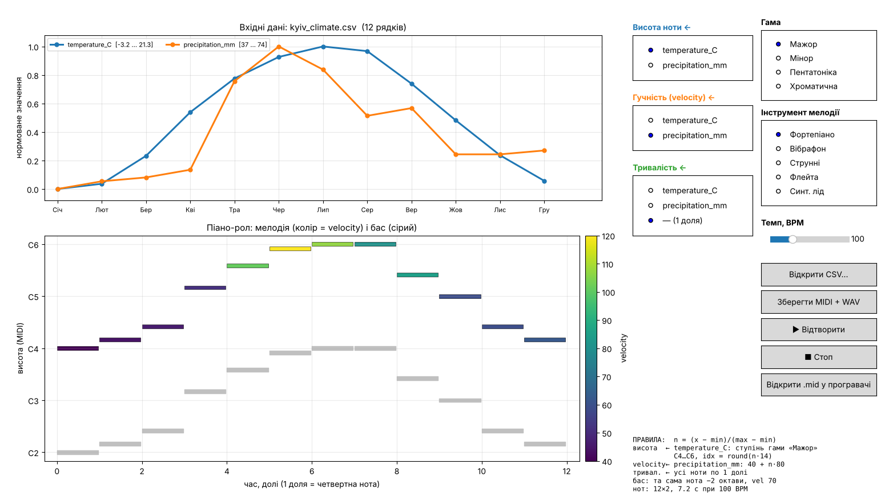

# Лабораторна робота №2 — соніфікація даних (варіант 2)

**Дисципліна:** Розробка мультимедійних систем  
**Виконав:** Марченко Данил, 4 курс, група ІПС-42, спеціальність 121 «Інженерія програмного забезпечення»  
КНУ імені Тараса Шевченка, факультет комп’ютерних наук та кібернетики

📄 **Звіт:** [report/ЛР2_Звіт_Марченко.pdf](report/ЛР2_Звіт_Марченко.pdf) ([docx](report/ЛР2_Звіт_Марченко.docx))

Застосунок перетворює числові дані з CSV на MIDI-композицію.



## Правила перетворення
Кожен показник нормується: `n = (x − min) / (max − min)`, кожен рядок даних = одна нота.

| Параметр MIDI | Правило |
|---|---|
| Висота ноти | ступінь обраної гами в діапазоні C4…C6: `idx = round(n · k · 2)` |
| Velocity | `40 + 80 · n` (40…120) |
| Тривалість (необов’язково) | 0,5 / 1 / 1,5 / 2 долі |
| Бас (2-га доріжка) | та сама нота −2 октави, velocity 70 |
| Інструмент, темп, гама | обирає користувач |

MIDI тип 1 (темп + мелодія + бас), 480 тіків на долю, бібліотека `mido`.

## Можливості
- будь-який CSV, вибір стовпця для кожного параметра без зміни коду
- 4 гами, 5 інструментів, темп 60–200 BPM
- графік даних і піано-рол на спільній шкалі часу
- відтворення з курсором (вбудований синтезатор → WAV), збереження .mid/.wav
- режим командного рядка

## Запуск
```bash
python3 -m venv venv && source venv/bin/activate
pip install -r requirements.txt
python test_sonify.py
python app.py                          # клімат Києва (температура, опади)
python app.py data/demo_signals.csv    # 3 показники
python sonify.py data/kyiv_climate.csv --pitch temperature_C --velocity precipitation_mm -o out.mid
```

## Файли
| Файл | Призначення |
|---|---|
| `sonify.py` | читання CSV, правила, запис MIDI, синтез WAV |
| `app.py` | графічний інтерфейс |
| `test_sonify.py` | тести |
| `data/` | вхідні дані |

---
© 2026 Марченко Данил, ІПС-42
